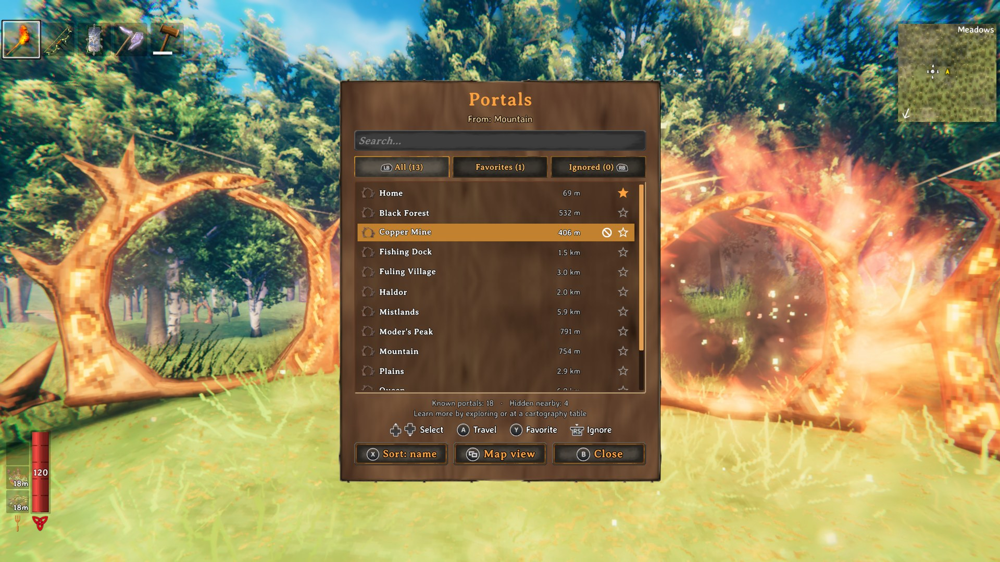
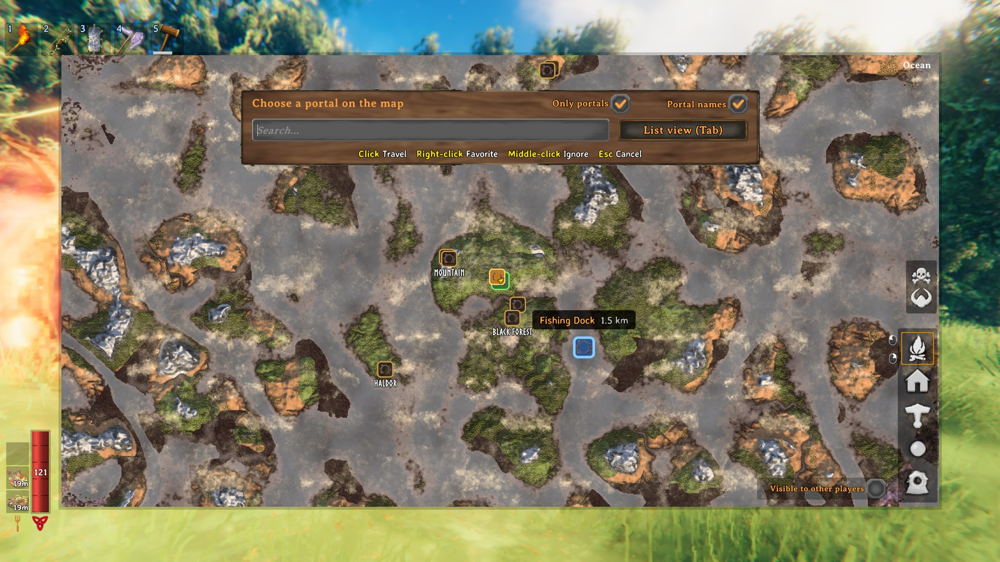
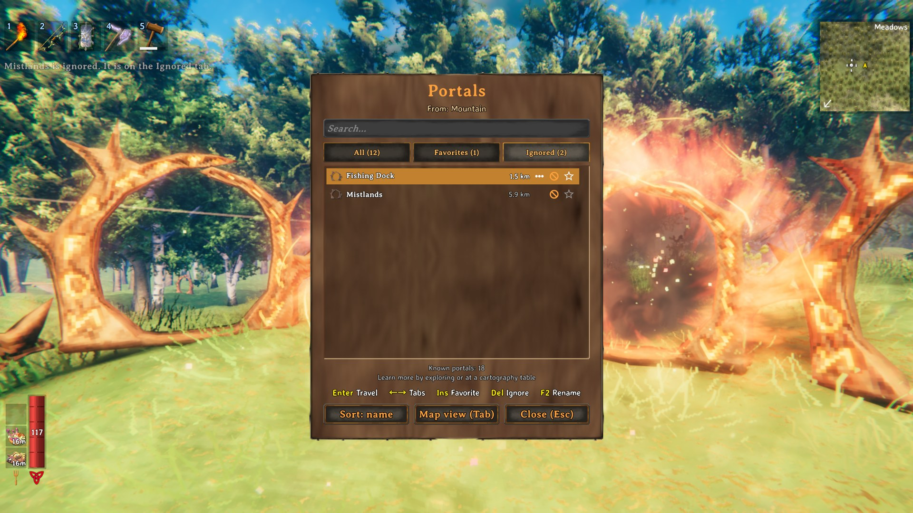
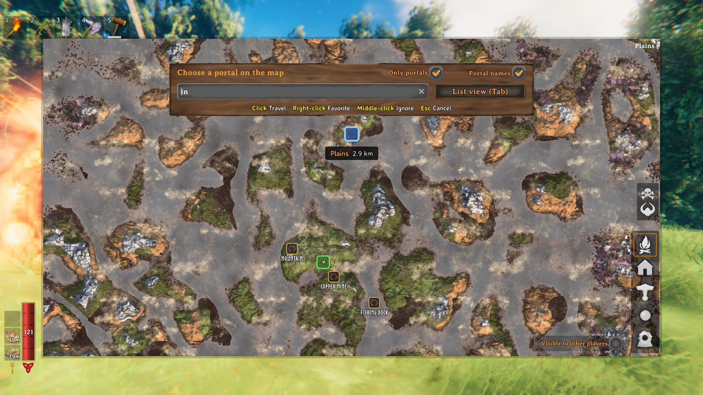
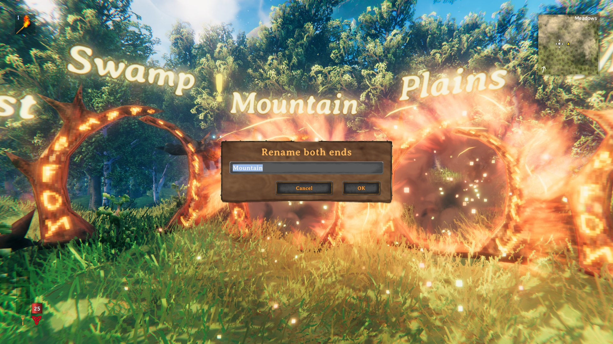
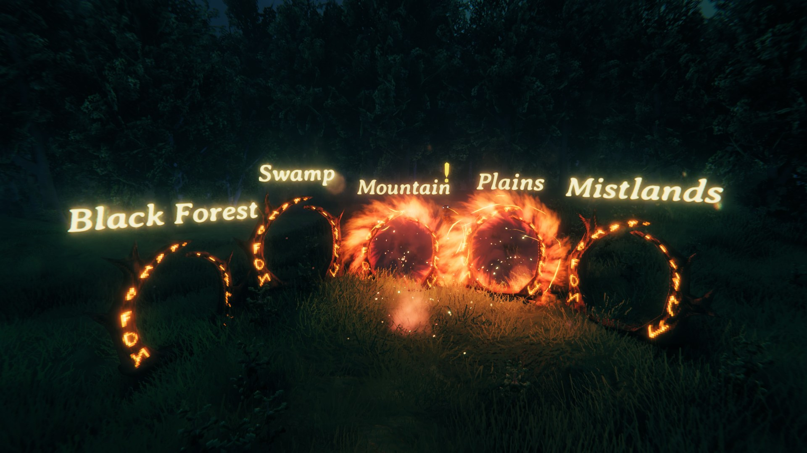
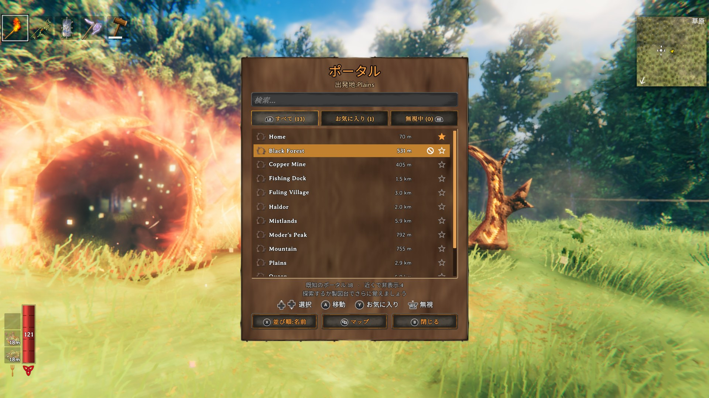

# ClientPortals

Pick your portal destination from a list or on the map. No need for tag pairs or portal hubs anymore, though vanilla pairs keep working. Learn portals by exploring, and **share them with your friends at the cartography table**. Fully playable with a **gamepad** (Steam Deck included), and built from the game's own UI, so it looks and sounds like part of Valheim.

**100% client-side.** Nothing to install on the server: it works on any dedicated server, on a friend's local host and in single player, and the other players don't need it either. Anyone who installs it can use it.

**In your language.** Translated into all 35 languages the game ships, following its language setting (or the mod's own `Language` setting).

## How it works

Look at any portal and press **Q** (on a gamepad: tap **L3**), or walk into an unpaired portal. The portals you know open in a list: pick one and you are there. Unpaired portals swirl like paired ones once you know somewhere to go, and vanilla tag pairs keep working as usual.

You learn a portal by:

| How                   | When                                                                                                         |
|-----------------------|--------------------------------------------------------------------------------------------------------------|
| **Visit it**          | Get within 20 m of a portal                                                                                  |
| **Tag pairs**         | Get close to a vanilla tag-paired portal and you also learn the one on the other side, without going through |
| **Cartography table** | Read the map to learn every portal recorded on the table, write it to record yours                           |

Single player and local hosts know every portal in the world from the start (configurable).

**Moved or destroyed portals don't strand you.** A known portal destroyed anywhere while you play leaves your list at once. If one went while you weren't around, the trip checks the destination under the loading screen: a portal rebuilt nearby under the same name takes you in (and replaces the old one in your list, favorite kept); with none, you come back to the portal you left from, and the old one leaves your list.

## The list

Search by name, sort by name or distance, and star your favorites to keep them on top. The **All**, **Favorites** and **Ignored** tabs switch between them. The **…** mark (F2) renames a portal from afar: a tag pair is renamed at both ends, so it stays connected (only a portal you have been near since joining the game: the game hasn't sent you the others).

Portal rooms fill a list with portals you never want to pick:

- **Ignore** a portal to move it to the **Ignored** tab (and back the same way). Unnamed portals count as one: ignoring one ignores them all.
- **Same names** (`HideTwins`, on by default): of portals sharing a name, only the one farthest away is shown. In your portal room, that's the far end of each tag pair.
- `HideNearby` hides every portal close to the one you use.

|                                          | Mouse / keyboard                          | Gamepad                                    |
|------------------------------------------|-------------------------------------------|--------------------------------------------|
| Pick a portal                            | hover, or Up/Down (PageUp/PageDown)       | D-pad or left stick (triggers jump a page) |
| Travel                                   | click, or Enter                           | A (Cross)                                  |
| Favorite                                 | click the star, or Insert                 | Y (Triangle)                               |
| Ignore (or stop ignoring)                | click the ⊘ mark, middle-click, or Delete | right stick press (R3)                     |
| Rename                                   | click the … mark, or F2                   | —                                          |
| Tabs                                     | click, or Left/Right                      | LB/RB (L1/R1) or D-pad left/right          |
| Sort: name / nearest / farthest          | click the Sort button                     | X (Square)                                 |
| Switch to the map view (with the search) | Tab, or the Map view button               | the map button (View / touchpad)           |
| Search                                   | type (the × empties it)                   | —                                          |
| Clear the search, then close             | Esc                                       | B (Circle)                                 |

## Map view

Tab (or **Map view**) turns the list into the game map with every portal you know on it, even in areas you haven't explored, its name written underneath (**Portal names**). Hover a portal for its name and distance, click it to travel, right-click it for a favorite, middle-click it to ignore it. **Only portals** hides the map's other pins. The search works here too: the map zooms to the matching portals, and Enter travels when only one is left. Tab or the map key goes back to the list, Esc clears the search and then closes. The view you used last opens next time (`View`).

With a gamepad, move a portal under the crosshair (LB/RB jump from portal to portal): A travels, Y marks a favorite, R3 ignores, X shows only portals, L3 the names, the triggers zoom, B clears the search and then cancels.

## Cartography table: a shared atlas of portals

The cartography table already shares the explored map. With ClientPortals it also keeps an **atlas of portals**: **Write map** records every portal you know, **Read map** teaches you every portal recorded there, and the table's hover text shows how many it holds. Destroyed portals leave your list, and the table the next time you write to it. Players without the mod share the map as usual.

## Renaming both ends of a pair (optional)

Renaming one end of a vanilla tag pair breaks the pair. With `RenameBoth` on, **Shift + E** (`RenameKey`) at a paired portal (on a gamepad: alt + use) renames both ends at once, so the pair stays connected, also for players without the mod. Names can be up to `NameLimit` characters, in the game's own rename dialog too. Off by default, and while [TagConnectedPortals](https://thunderstore.io/c/valheim/p/Neobotics/TagConnectedPortals/) is installed.

## Names above portals (optional)

With `Enabled` in the `Labels` section, each portal's name floats above it, hidden behind walls and far away; PageUp shows or hides them. Color, font and size are in the settings. Off by default, and while [Teleporter Overhead Text](https://thunderstore.io/c/valheim/p/ModdedWolf/Teleporter_Overhead_Text/) is installed.

## Languages

English, Bulgarian, Chinese (simplified and traditional), Croatian, Czech, Danish, Dutch, Finnish, French, Georgian, German, Greek, Hindi, Hungarian, Icelandic, Italian, Japanese, Korean, Latvian, Lithuanian, Macedonian, Norwegian, Polish, Portuguese (European and Brazilian), Romanian, Russian, Serbian, Slovak, Spanish, Swedish, Thai, Turkish, Ukrainian: the mod follows the game's language setting, or the `Language` setting to pick another one. Corrections are welcome.

## Good to know

- **Why learning?** On a dedicated server, the game only sends each player the portals near them. A client-side mod can't see the others until someone has been close to them, so portals are learned by visiting, through tag pairs, or from the cartography table.
- The game's rules still apply: no travel with ores or other restricted items (unless the portal allows them), and none when the world disables portals or during a boss fight with that option on.
- Known portals, favorites and ignored portals are saved with your character, separately for each world. Favorites and ignored portals are personal: they are not shared at the cartography table.
- With Zen.ModLib's "Alternate Interact Key" on Q (its default, like `TravelKey`), Q at a portal opens the destinations and Zen's alternate interaction stays for everything else.
- ClientPortals never changes portal tags or connections on its own: only when you rename a portal yourself.

## Configuration

`BepInEx/config/rgeraskin.ClientPortals.cfg`. Every setting is your own: nothing is synced from the server. [Configuration Manager](https://thunderstore.io/c/valheim/p/Azumatt/Official_BepInEx_ConfigurationManager/) (F1) changes them in game.

| Section  | Key                  | Default         | Description                                                                                                                                       |
|----------|----------------------|-----------------|---------------------------------------------------------------------------------------------------------------------------------------------------|
| General  | `Language`           | `Auto`          | Language of the mod's texts; `Auto` follows the game                                                                                              |
| Learning | `Nearby`             | `true`          | Learn a portal when you get close to it                                                                                                           |
| Learning | `NearbyDistance`     | `20`            | How close (in meters) you need to get to a portal to learn it (5 to 100)                                                                          |
| Learning | `TagPairs`           | `true`          | Near a tag-paired portal, also learn the portal on the other side                                                                                 |
| Learning | `CartographyTable`   | `true`          | Read/write portals at the cartography table                                                                                                       |
| Learning | `HostKnowsAll`       | `true`          | Single player or hosting: every portal is already known. `false` = learn them like on a dedicated server                                          |
| Learning | `ForgetMissing`      | `true`          | When you get close to where a known portal was and it is gone, it is removed from your list                                                       |
| List     | `HideNearby`         | `false`         | Hide portals close to the portal you are using (list and map)                                                                                     |
| List     | `HideNearbyDistance` | `30`            | Distance in meters used by `HideNearby` (5 to 500)                                                                                                |
| List     | `SortBy`             | `Name`          | Sort the list by `Name`, `Nearest` first or `Farthest` first (also changeable in the list window)                                                 |
| List     | `FavoritesFirst`     | `true`          | Favorite portals always come first                                                                                                                |
| List     | `HideTwins`          | `true`          | Of portals with the same name, show only the one farthest from the portal you use (list and map)                                                  |
| Portal   | `ShowActive`         | `true`          | Unpaired portals light up (color and swirl) when you know other destinations. Visual only, on your game                                           |
| Portal   | `WalkIn`             | `true`          | Walking into an unpaired portal opens the destination list. Tag-paired portals keep the vanilla behavior                                          |
| Portal   | `View`               | `Last`          | What a portal opens: `List`, `Map`, or the `Last` view you used                                                                                   |
| Portal   | `TravelKey`          | `Q`             | Opens the destinations at the portal you look at (gamepad: a tap on L3). Held at a portal, it doesn't also do its game action (Q: run on its own) |
| Rename   | `RenameBoth`         | `false`         | Rename both ends of a tag-paired portal at once at the portal (`RenameKey`, or alt + use on a gamepad)                                            |
| Rename   | `RenameKey`          | `LeftShift + E` | The key that renames both ends at a paired portal                                                                                                 |
| Rename   | `NameLimit`          | `15`            | Most characters of a portal name when renaming: both ends, from the list, and the game's own dialog (10 to 100; the game allows 10)               |
| Map      | `OnlyPortals`        | `false`         | The map view shows only the portals, not the map's other pins (also a switch on the map)                                                          |
| Map      | `ShowNames`          | `true`          | The map view writes each portal's name under it where names don't overlap, not only on hover (also a switch on the map)                           |
| Labels   | `Enabled`            | `false`         | Portal names float above the portals                                                                                                              |
| Labels   | `ToggleKey`          | `PageUp`        | Shows or hides the names in game                                                                                                                  |
| Labels   | `HeightOffset`       | `2.5`           | Height above the portal, in meters (0.5 to 8)                                                                                                     |
| Labels   | `Font`               | `Game`          | `Game`, `Arial`, or a font installed on your computer                                                                                             |
| Labels   | `Size` / `FontSize`  | `0.12` / `64`   | Size in the world / sharpness of the letters                                                                                                      |
| Labels   | `ColorPreset`        | `SoftGold`      | `Custom` (the `Color` setting), White, SoftGold, Red, Green, Blue, Yellow, Cyan, Magenta, Orange, RGBCycleSlow/Medium/Fast                        |
| Labels   | `Color`              | `FFB838FF`      | The custom color (its alpha also applies to the rainbow cycles)                                                                                   |
| Labels   | `MaxDistance`        | `40`            | Names farther than this are hidden (0: any distance)                                                                                              |
| Labels   | `RequireLineOfSight` | `true`          | Hide a name when a wall hides its portal                                                                                                          |
| Labels   | `ShowWhenEmpty`      | `false`         | Unnamed portals show a placeholder                                                                                                                |
| Labels   | `UpdateInterval`     | `0.5`           | Seconds between reading the names again                                                                                                           |

## Installation

Needs only [BepInExPack Valheim](https://thunderstore.io/c/valheim/p/denikson/BepInExPack_Valheim/). Install with a mod manager, or put `ClientPortals.dll` into `BepInEx/plugins`. Only you need it: not the server, not the other players.

Tested on Valheim 1.0.21 with BepInExPack 5.4.2351 on Windows and macOS, with keyboard and mouse and with a gamepad: in single player, on dedicated servers (also with crossplay), in player-hosted games, and alongside players who don't have the mod; also with Zen.ModLib.

## Development

Built with dotnet from [mise](https://mise.jdx.dev): `mise run build`, `mise run test` (unit tests), `mise run package` (the mod's zip). The architecture and the in-game test harness are described in [CLAUDE.md](https://github.com/rgeraskin/valheim-client-portals/blob/master/CLAUDE.md).

## Credits

- Inspired by [EasyPortal](https://www.nexusmods.com/valheim/mods/4147) (hrossow), also client-side. ClientPortals is the same idea written from scratch: open source, full gamepad support, 35 languages, a map view you can switch to with search and portal names, ignoring portals, renaming from the list, a redesigned interface built from the game's own UI, etc.
- The names above portals take their settings from [Teleporter Overhead Text](https://thunderstore.io/c/valheim/p/ModdedWolf/Teleporter_Overhead_Text/) (ModdedWolf), and renaming both ends follows [TagConnectedPortals](https://thunderstore.io/c/valheim/p/Neobotics/TagConnectedPortals/) (Neobotics): with either mod installed, ClientPortals leaves that feature to it.
- The title on the mod's images is set in [Cinzel](https://fonts.google.com/specimen/Cinzel) (Natanael Gama, SIL Open Font License).

## Made with AI

This mod — code, translations, tests, images and this text — was made entirely with AI, and tested in the game.

## License

MIT, see [LICENSE](https://github.com/rgeraskin/valheim-client-portals/blob/master/LICENSE). Source code: [github.com/rgeraskin/valheim-client-portals](https://github.com/rgeraskin/valheim-client-portals).

Found a bug or have an idea? Please report it on the [GitHub issues page](https://github.com/rgeraskin/valheim-client-portals/issues).
